# Pokédex - Memoria de Desarrollo

* **Nombre del proyecto:** Mini-Pokédex (Pokédex de Kanto - 1ª Generación)
* **Autor:** Yasiel
* **Asignatura / Módulo:** Programación Multimedia y Dispositivos Móviles (DAM)
* **Tecnologías utilizadas:**
  * **HTML5:** Estructura semántica completa, formulario accesible, elemento nativo `<dialog>`.
  * **CSS3:** Maquetación con Flexbox y CSS Grid, diseño responsivo (*mobile-first*), pseudoelementos `::backdrop`, microanimaciones e interactividad visual.
  * **JavaScript (ES6+ Vanilla):** Sin dependencias, frameworks ni bibliotecas externas.
  * **API Externa:** PokéAPI v2 (`https://pokeapi.co/api/v2/pokemon/{id}`).


---

## 📋 Índice General de la Memoria

1. [Punto de partida](#1-punto-de-partida)
2. [Carga de los 151 Pokémon](#2-carga-de-los-151-pokémon)
3. [Construcción de las tarjetas](#3-construcción-de-las-tarjetas)
4. [Barra de búsqueda y filtros](#4-barra-de-búsqueda-y-filtros)
5. [Información ampliada](#5-información-ampliada)
6. [Gestión de estados y errores](#6-gestión-de-estados-y-errores)
7. [Fases de desarrollo y commits](#7-fases-de-desarrollo-y-commits)
8. [Pruebas finales obligatorias](#8-pruebas-finales-obligatorias)
9. [Conclusiones y balance del proyecto](#9-conclusiones-y-balance-del-proyecto)
10. [Información del proyecto y entrega](#10-información-del-proyecto-y-entrega)
11. [🎯 Prácticas Finales de Evaluación (Fácil, Media y Difícil)](#11-prácticas-finales-de-evaluación-fácil-media-y-difícil)
    * [11.1. Práctica 1: Nivel Fácil](#111-práctica-1-nivel-fácil)
    * [11.2. Práctica 2: Nivel Medio](#112-práctica-2-nivel-medio)
    * [11.3. Práctica 3: Nivel Difícil](#113-práctica-3-nivel-difícil)
    * [11.4. Guía Rápida de Soluciones, Código y Comandos de Emergencia](#114-guía-rápida-de-soluciones-código-y-comandos-de-emergencia)

---

## 1. Punto de partida

### Explicación breve de la mini-Pokédex inicial
En este proyecto nuestra misión es mejorar la mini-Pokédex desarrollada durante la práctica guiada previa. Desde el estado inicia ya partimos de una aplicación que permite realizar consultas individuales a la [PokéAPI](https://pokeapi.co/) mediante un formulario de búsqueda. Para iniciar una busqueda el usuario indroduce el nombre o el número de un Pokémon y la aplicación hace una petición a la API de forma asíncrona, mostrando una tarjeta básica con su información esencial.

---

### Estructura inicial de carpetas y archivos

La estructura de partida del proyecto se compone de los siguientes archivos y directorios:

```text
mini-pokedex/
├── index.html              # Estructura HTML con el formulario y contenedor de resultados
├── css/
│   └── style.css           # Estilos base, diseño de la tarjeta inicial y buscador
├── js/
│   └── app.js              # Lógica de petición individual fetch, renderizado y eventos
└── assets/
    └── readme/             # Directorio para almacenar las capturas de pantalla de evidencias
```

---

### Funcionalidades que ya estaban implementadas

1. **Búsqueda por nombre o identificador:**
   - La función `obtenerPokemon(busqueda)` realiza una petición `fetch()` al endpoint `https://pokeapi.co/api/v2/pokemon/{busqueda}`.
   - Es capaz de localizar al Pokémon tanto si se introduce su nombre en minúsculas (ej. `pikachu`) como su número en la Pokédex (ej. `25`).

2. **Transformación y formateo de datos:**
   - **Identificador formateado:** La función `formatearId(id)` añade ceros a la izquierda mediante `padStart(3, "0")` (por ejemplo, mostrando `N.º 025`).
   - **Conversión de medidas:** La API devuelve la altura en decímetros y el peso en hectogramos, por lo que el código los divide entre 10 para mostrarlos en metros (`m`) y kilogramos (`kg`) respectivamente.
   - **Tipos:** Se extrae el array de tipos del Pokémon mediante `.map()` y se genera una etiqueta visual `<span class="tipo">` para cada uno.

3. **Renderizado dinámico de la tarjeta:**
   - La función `mostrarPokemon(pokemon)` inyecta dinámicamente en el contenedor `#resultado` la tarjeta con el número, imagen (`sprites.front_default`), nombre capitalizado, altura, peso y tipos.

4. **Validación y gestión de estados y errores:**
   - Si el usuario envía el formulario vacío, se muestra el aviso *"Introduce un nombre o número."*.
   - Mientras se procesa la solicitud, se muestra el mensaje de estado *"Cargando..."* y se deshabilita temporalmente el botón de búsqueda para evitar peticiones duplicadas.
   - Si el Pokémon no existe o la API devuelve un código de error HTTP (`!respuesta.ok`), se lanza una excepción controlada que muestra en pantalla *"Pokémon no encontrado."* sin provocar errores no controlados en la consola.

---

### Evidencias gráficas (Capturas)

#### 1. Aplicación cargada y funcionando (Estado inicial)
En esta imagen se puede ver como la Pokedex esta cargada y funcionando sin ningun error.

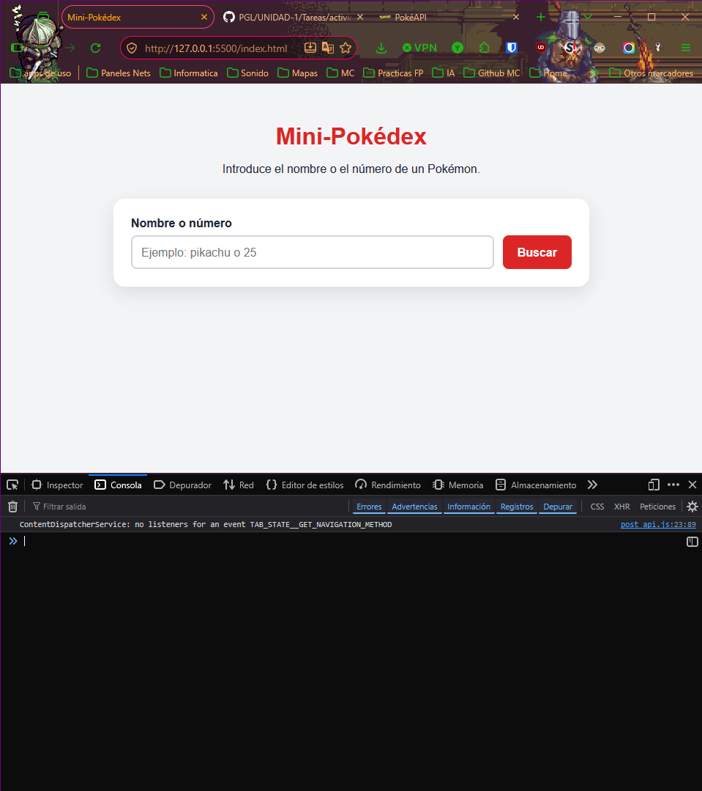

#### 2. Búsqueda correcta de un Pokémon
En esta podemos ver como se muestra un pokemon tras buscar (ej. Pikachu con ID #025), y así visualizarlo en su tarjeta completa.

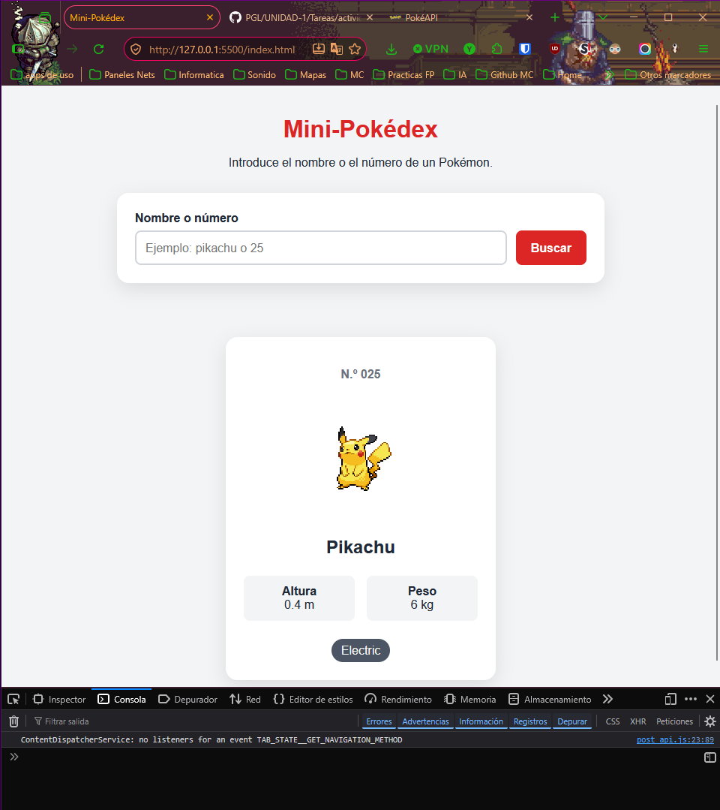

#### 3. Gestión de un Pokémon inexistente (Error controlado)
En esta imagen se muestra la interfaz al buscar un término que no existe en la API, mostrando un mensaje de error controlado sin romper nuestra Pokedex.

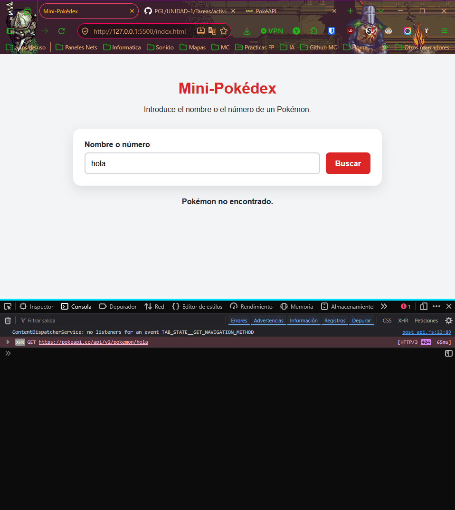

---

### Identificador del commit del punto de partida

* **Commit inicial:** [`2e0bccf`](https://github.com/Lospro772/PGL-2-DAM/commit/2e0bccf)
* **Mensaje del commit:** `docs: Punto de partida funcional de la mini-pokedex inicial`

---

## 2. Carga de los 151 Pokémon

En esta fase preparamos la consulta asíncrona para obtener los datos de la primera generación desde PokéAPI y comprobar que podíamos gestionar la colección completa en memoria.

### 1. Consulta concurrente con `Promise.all`
Para no realizar 151 peticiones una detrás de otra (lo que tardaría más de 20 segundos y bloquearía el navegador), lanzamos todas las llamadas en paralelo mediante `Promise.all`.

```javascript
const promesas = [];
for (let i = 1; i <= 151; i++) {
  promesas.push(
    fetch(`https://pokeapi.co/api/v2/pokemon/${i}`).then((res) => {
      if (!res.ok) throw new Error(`Error en Pokémon #${i}`);
      return res.json();
    })
  );
}

const datosCrudos = await Promise.all(promesas);
const todosLosPokemon = datosCrudos.map((dato) => new Pokemon(dato));
```

### 2. Gestión de estados durante la carga
* **Mensaje de carga:** Mientras las peticiones se procesan en segundo plano, informamos al usuario mostrando el texto *"Cargando Pokémon..."* en el elemento `#mensaje`.
* **Fin de carga:** Al terminar la descarga, limpiamos el mensaje para dejar la interfaz despejada.
* **Control de errores:** Si alguna petición falla por corte de conexión, capturamos el fallo con `try/catch` para que no se quede bloqueada la página.

---

### Evidencias gráficas (Capturas de la Fase 2)

#### 1. Mensaje de estado durante la carga
En esta imagen mostramos el aviso informativo en pantalla mientras se realiza la consulta de los 151 Pokémon.

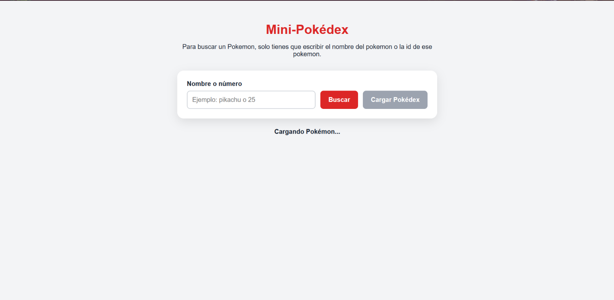

#### 2. Array de los 151 Pokémon en consola
En esta imagen mostramos desde la consola del navegador el array de 151 objetos obtenidos y listos en memoria.

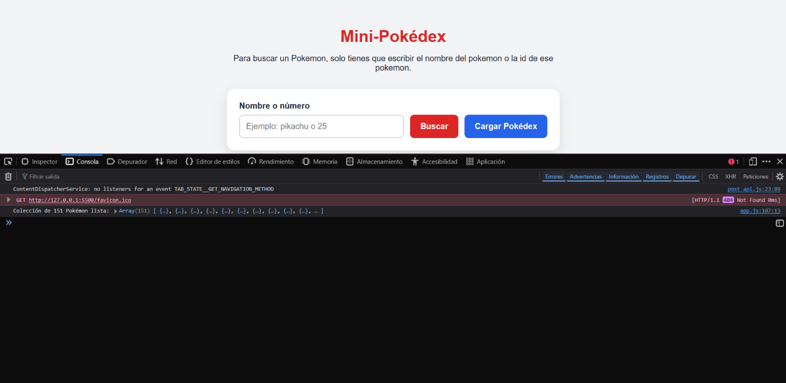

---

### Identificador del commit de esta fase

* **Commit fase 2:** [`1d0374f`](https://github.com/Lospro772/PGL-2-DAM/commit/1d0374f)
* **Mensaje del commit:** `feat: Consulta concurrente y carga en memoria de los 151 Pokemon con Pokemon.js`

---

## 3. Construcción de las tarjetas y efecto Hover de Sprites
En esta parte, nos hemos centrado en mejorar el diseño de la interfaz y la interacción de las tarjetas que muestran la información  de cada pokemon.

### 1. Creación de la clase `Pokemon.js`
En lugar de manejar todos los objetos en el `js/app.js` creamos el archivo `js/Pokemon.js` con la clase `Pokemon`.

Por otro lado la PokéAPI, devuelve un JSON enorme con bastante información que no utilizaremos en esta practica, por lo tanto nos quedaremos solo con la información que vamos a utilizar:
* **Identificador y nombre:** `id` y `nombre`.
* **Ambos sprites:** Guardamos tanto la imagen trasera (`sprites.back_default`) como la frontal (`sprites.front_default`) para poder alternarlas.
* **Tipos:** Extraemos los nombres de los tipos en un array sencillo de texto.
* **Conversión de unidades:**
  * La altura viene en decímetros desde la API, así que la dividimos entre 10 para mostrarla en **metros** (`m`).
  * El peso viene en hectogramos, así que lo dividimos entre 10 para mostrarlo en **kilogramos** (`kg`).
* **Estadísticas y habilidades:** extraemos la experiencia base, la lista de habilidades y las 6 estadísticas base (`hp`, `attack`, `defense`, `special-attack`, `special-defense`, `speed`), dejándolas preparadas para la futura ventana de detalles.

Para que pueda funcionar enlazamos el archivo principal `index.html` justo antes de `app.js` para que la clase esté disponible al cargar la página.

### 2. Tarjeta con sprite inicial de espaldas y efecto Hover
Para poder hacer la función de ver al Pokemon tanto de espalda como de frente se adapto la función `crearTarjetaHTML` y la lógica de interacción para cumplir con los requisitos 4.3 y 4.4:

1. **Sprite inicial de espaldas:** Al buscar un Pokémon, la tarjeta muestra por defecto su imagen trasera (`spriteBack`).
2. **Cambio de imagen sin llamadas a la API:** Para evitar hacer 2 peticiones a la API, guardamos las dos URLs en atributos personalizados de HTML (`data-back` y `data-front`). 
3. **Detección del cursor:** Utilizando los eventos de `mouseenter` y `mouseleave` creados previamente, cuando el usuario pasa el ratón sobre la tarjeta o la imagen, el sprite cambia automáticamente al de frente. Y al retirar el ratón, vuelve a verse de espaldas.
4. **Botón de detalles:** También agregamos el botón *"Ver detalles"* en la parte inferior de la tarjeta para preparar la futura ventana modal.

### Código clave implementado:
Aquí se puede ver la función que implementa esta lógica de cambio de sprites:

```javascript
// Alterna entre el sprite trasero y frontal al colocar o retirar el cursor
const activarHoverSprites = () => {
  const tarjetas = document.querySelectorAll(".pokemon");

  tarjetas.forEach((tarjeta) => {
    const img = tarjeta.querySelector(".pokemon__imagen");
    if (!img) return;

    // Al poner el ratón encima: cambia al sprite de frente
    tarjeta.addEventListener("mouseenter", () => {
      if (img.dataset.front) img.src = img.dataset.front;
    });

    // Al retirar el ratón: vuelve al sprite de espaldas
    tarjeta.addEventListener("mouseleave", () => {
      if (img.dataset.back) img.src = img.dataset.back;
    });
  });
};
```

---

### Evidencias gráficas (Capturas de la Fase 3)

#### 1. Tarjeta con sprite inicial de espaldas
Muestra el resultado tras buscar un Pokémon (ej. Pikachu con ID #025), viéndose inicialmente de espaldas, con sus medidas convertidas a metros y kilos y el botón de detalles.

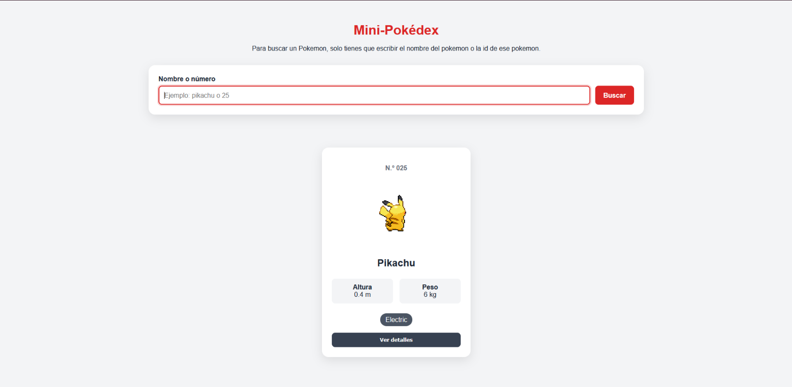

#### 2. Cambio a sprite frontal al pasar el cursor (Hover)
Muestra la misma tarjeta cuando colocamos el cursor encima, cambiando la imagen al sprite frontal sin recargar la página.

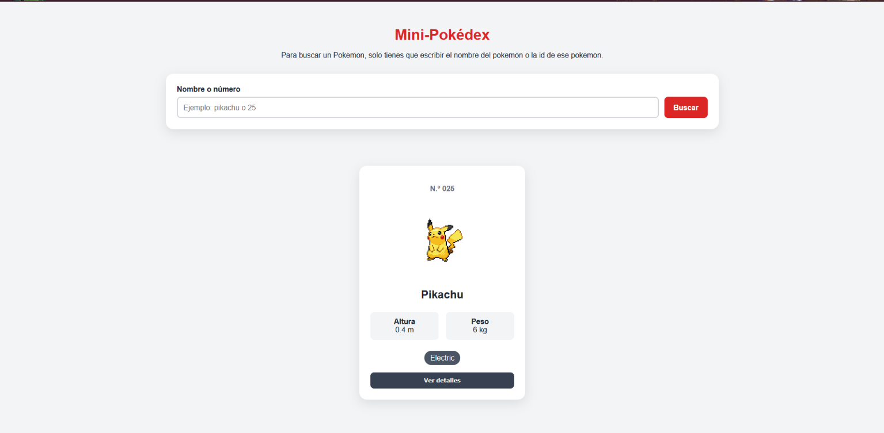

---

### Identificador del commit de esta fase

* **Commit fase 3:** [`4e2d7e2`](https://github.com/Lospro772/PGL-2-DAM/commit/4e2d7e2)
* **Mensaje del commit:** `feat: Modelo Pokemon.js, tarjeta con medidas en metros/kilos y efecto hover de sprites`

---

## 4. Barra de búsqueda en tiempo real y por fragmentos (4.5)

En esta fase mejoramos el buscador para que no se limite únicamente a nombres o números exactos, sino que permita buscar por fragmentos de texto y en tiempo real mientras el usuario escribe.

### 1. El reto técnico de buscar por fragmentos
La PokéAPI por sí sola no permite buscar trozos de palabras: si le pides `char`, la API responde con un error 404 (no encontrado).

Para resolver esto y cumplir con el requisito 4.5:
1. **Precarga en memoria:** Al abrir la aplicación, descargamos los 151 Pokémon en segundo plano mediante la función `cargarPokemonsEnMemoria()` y los guardamos en el array `todosLosPokemon`.
2. **Filtrado instantáneo:** Cuando el usuario interactúa con la barra, en lugar de consultar a internet, filtramos directamente sobre el array con el método `.filter()`. Esto hace que las búsquedas sean inmediatas y no consuman datos repetidos de la API.

### 2. Lógica de búsqueda implementada
* **Búsqueda por fragmentos:** Usamos `.includes(busqueda)` sobre el nombre del Pokémon. De este modo, al escribir `char`, el filtro encuentra a Charmander, Charmeleon y Charizard, y genera sus tarjetas a la vez.
* **Búsqueda por número e ID:** Comprobamos tanto el número normal (`25`) como el formateado con ceros (`025`).
* **Normalización:** Aplicamos `.trim()` para eliminar espacios accidentales y `.toLowerCase()` para que no distinga entre mayúsculas y minúsculas.
* **Búsqueda en tiempo real:** Escuchamos el evento `input` en la barra de texto, de modo que los resultados se van actualizando según teclea el usuario, sin obligarle a pulsar el botón ni la tecla Enter.
* **Gestión de casos sin resultados:** Si el término no coincide con ningún Pokémon (por ejemplo `agumon`), mostramos un mensaje amigable avisando al usuario y vaciamos el contenedor de resultados.
* **Limpieza:** Al borrar completamente la barra de búsqueda, la pantalla vuelve a quedar limpia.

### Código clave implementado:

```javascript
// Función que filtra los Pokémon en memoria según lo que escribe el usuario
const filtrarPokemon = () => {
  const busqueda = inputBusqueda.value.trim().toLowerCase();

  // Si la barra está vacía, dejamos la pantalla limpia
  if (!busqueda) {
    mensaje.textContent = "";
    resultado.innerHTML = "";
    return;
  }

  // Filtramos por nombre (incluyendo fragmentos) o por número de ID
  const encontrados = todosLosPokemon.filter((p) => {
    const coincideNombre = p.nombre.toLowerCase().includes(busqueda);
    const coincideId = String(p.id) === busqueda || formatearId(p.id) === busqueda;
    return coincideNombre || coincideId;
  });

  // Si no hay coincidencias, avisamos con un mensaje comprensible
  if (encontrados.length === 0) {
    mensaje.textContent = `No se han encontrado Pokémon con "${busqueda}".`;
    resultado.innerHTML = "";
    return;
  }

  // Si hay resultados, pintamos las tarjetas y activamos el hover
  mensaje.textContent = "";
  resultado.innerHTML = encontrados.map(crearTarjetaHTML).join("");
  activarHoverSprites();
};

// Escuchamos el evento 'input' para buscar en tiempo real mientras se escribe
inputBusqueda.addEventListener("input", filtrarPokemon);
```

---

### Evidencias gráficas (Capturas de la Fase 4)

#### 1. Búsqueda por número o nombre completo
Muestra el resultado al buscar un Pokémon específico como Pikachu mediante su nombre o su identificador (`25`).

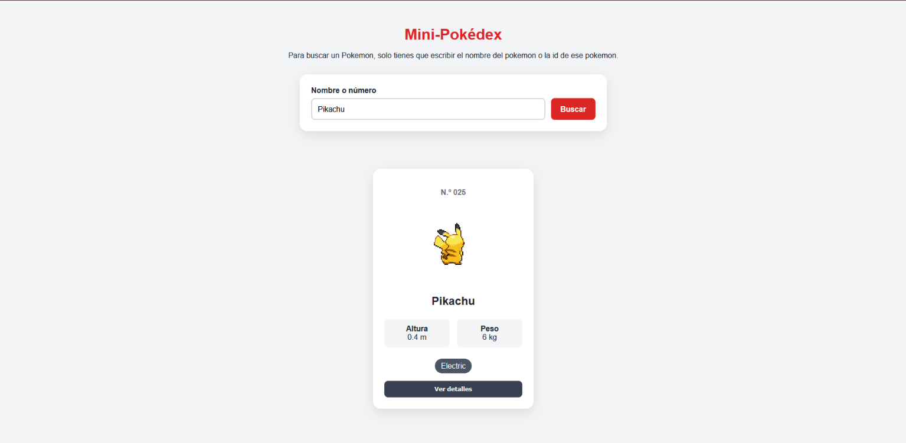

#### 2. Búsqueda por fragmento (`char`)
Muestra el funcionamiento del filtrado por fragmento al teclear `char`, apareciendo simultáneamente Charmander, Charmeleon y Charizard.

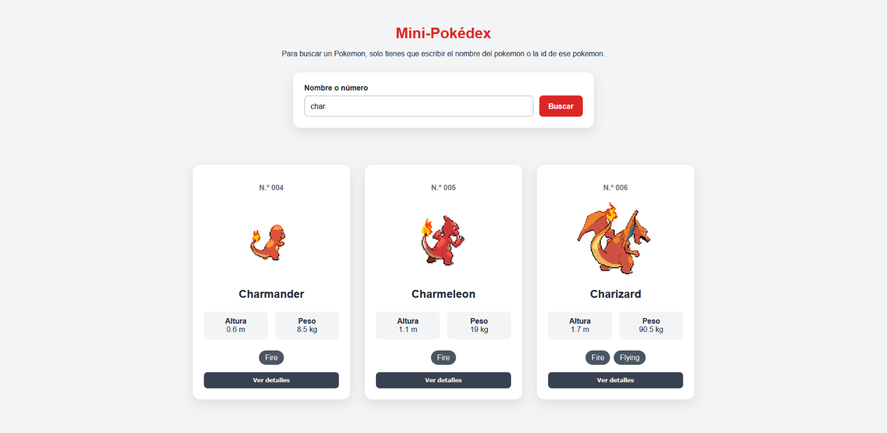

#### 3. Búsqueda sin coincidencias (Error controlado)
Muestra el mensaje que informa al usuario cuando no existen Pokémon con ese criterio (ej. `agumon`), manteniendo la interfaz limpia y sin errores técnicos en consola.

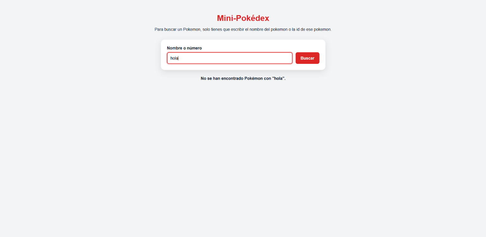

---

### Identificador del commit de esta fase

* **Commit fase 4:** [`384789c`](https://github.com/Lospro772/PGL-2-DAM/commit/384789c)
* **Mensaje del commit:** `feat: Busqueda en tiempo real por nombre, numero y fragmento con control sin resultados`

---

## 5. Información ampliada y ventana modal (Requisito 4.6)

En esta fase añadimos una ventana emergente (modal) que permite consultar toda la información detallada de cada Pokémon al pulsar sobre su botón **"Ver detalles"**, sin necesidad de recargar la página ni realizar peticiones adicionales a la API.

### 1. Decisiones técnicas y estructura elegida

* **Uso del elemento nativo `<dialog>` de HTML5:** En lugar de crear un `<div>` flotante con manipulación manual de visibilidad, usamos la etiqueta `<dialog>`. Esto nos aporta ventajas nativas del navegador:
  * Apertura modal con `showModal()`, que bloquea de forma accesible la interacción con el resto de la página.
  * Fondo atenuado personalizable a través del pseudo-elemento `::backdrop` con efecto de desenfoque (`backdrop-filter`).
  * Cierre accesible nativo con la tecla `Escape`.
* **Aprovechamiento de los datos en memoria:** Como en la Fase 3 ya guardamos en la clase `Pokemon` la experiencia base, las habilidades y las estadísticas completas, la apertura del modal es instantánea y no requiere descargas nuevas.
* **Delegación de eventos:** En lugar de vincular un evento a cada botón individual cada vez que se hace una búsqueda, colocamos un único escuchador en el contenedor `#resultado`. Usando `evento.target.closest(".pokemon__btn-detalles")` y el atributo `data-id="${pokemon.id}"`, detectamos con precisión qué Pokémon se quiere consultar.

### 2. Información mostrada en el modal

Al abrirse, el modal presenta de forma limpia y ordenada:
* **Identificación y nombre:** N.º de Pokédex y nombre del Pokémon.
* **Sprite frontal ampliado:** Imagen nítida de mayor tamaño (`200x200px`) con renderizado pixelado para preservar el aspecto original.
* **Tipos y medidas:** Etiquetas de tipo y valores de altura (en metros) y peso (en kilos).
* **Experiencia base y habilidades:** Puntos de experiencia base y listado de habilidades separadas por comas.
* **Cuadrícula de estadísticas base (Stats):** Una rejilla visual de dos columnas que detalla los 6 valores fundamentales:
  1. Puntos de Salud (`hp`)
  2. Ataque (`attack`)
  3. Defensa (`defense`)
  4. Ataque Especial (`specialAttack`)
  5. Defensa Especial (`specialDefense`)
  6. Velocidad (`speed`)

### 3. Métodos de cierre implementados

El modal se puede cerrar fácilmente de tres formas:
1. Pulsando el botón con la cruz (**X**) en la esquina superior derecha.
2. Haciendo clic fuera de la caja blanca del modal (sobre el fondo oscuro `::backdrop`).
3. Presionando la tecla **Escape** en el teclado.

### Código clave implementado:

```javascript
// Muestra la ventana modal con la información ampliada del Pokémon seleccionado
const abrirDetalles = (id) => {
  const pokemon = todosLosPokemon.find((p) => p.id === Number(id));
  if (!pokemon) return;

  const tiposHTML = pokemon.tipos
    .map((tipo) => `<span class="tipo">${tipo}</span>`)
    .join("");

  const habilidadesHTML = pokemon.habilidades.join(", ");

  modalCuerpo.innerHTML = `
    <p class="pokemon__numero">N.º ${formatearId(pokemon.id)}</p>
    
    <h2 class="pokemon__nombre">${pokemon.nombre}</h2>
    
    <div class="pokemon__tipos">${tiposHTML}</div>

    <div class="pokemon__datos">
      <p><strong>Altura</strong><br>${pokemon.altura} m</p>
      <p><strong>Peso</strong><br>${pokemon.peso} kg</p>
    </div>

    <p class="modal__habilidades">
      <strong>Experiencia base:</strong> ${pokemon.experiencia} exp<br>
      <strong>Habilidades:</strong> ${habilidadesHTML}
    </p>

    <div class="modal__stats">
      <div class="modal__stat-item"><strong>PS (HP):</strong> ${pokemon.stats.hp}</div>
      <div class="modal__stat-item"><strong>Ataque:</strong> ${pokemon.stats.attack}</div>
      <div class="modal__stat-item"><strong>Defensa:</strong> ${pokemon.stats.defense}</div>
      <div class="modal__stat-item"><strong>Atq. Especial:</strong> ${pokemon.stats.specialAttack}</div>
      <div class="modal__stat-item"><strong>Def. Especial:</strong> ${pokemon.stats.specialDefense}</div>
      <div class="modal__stat-item"><strong>Velocidad:</strong> ${pokemon.stats.speed}</div>
    </div>
  `;

  modal.showModal();
};

// Cierre mediante botón 'X' o clic en el fondo oscuro exterior
btnCerrarModal.addEventListener("click", () => modal.close());
modal.addEventListener("click", (e) => {
  if (e.target === modal) modal.close();
});

// Delegación de eventos en el contenedor de resultados
resultado.addEventListener("click", (evento) => {
  const boton = evento.target.closest(".pokemon__btn-detalles");
  if (boton) {
    abrirDetalles(boton.dataset.id);
  }
});
```

---

### Evidencias gráficas (Capturas de la Fase 5)

#### 1. Ventana modal abierta con estadísticas y habilidades
Muestra el modal activo al pulsar "Ver detalles" de un Pokémon (ej. Pikachu), con la imagen ampliada, su experiencia, habilidades y las 6 estadísticas base estructuradas en cuadrícula.

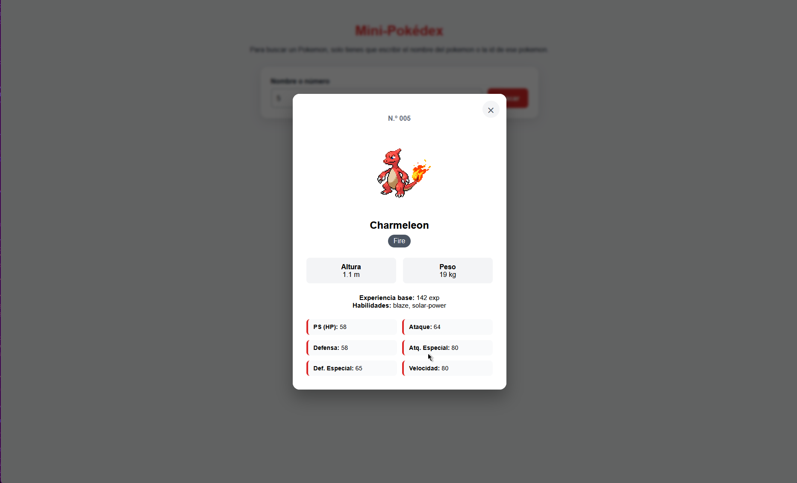

#### 2. Ventana modal cerrada
Muestra la vista de la aplicación tras cerrar la ventana modal, volviendo al estado de la búsqueda sin recargar ni alterar la página.

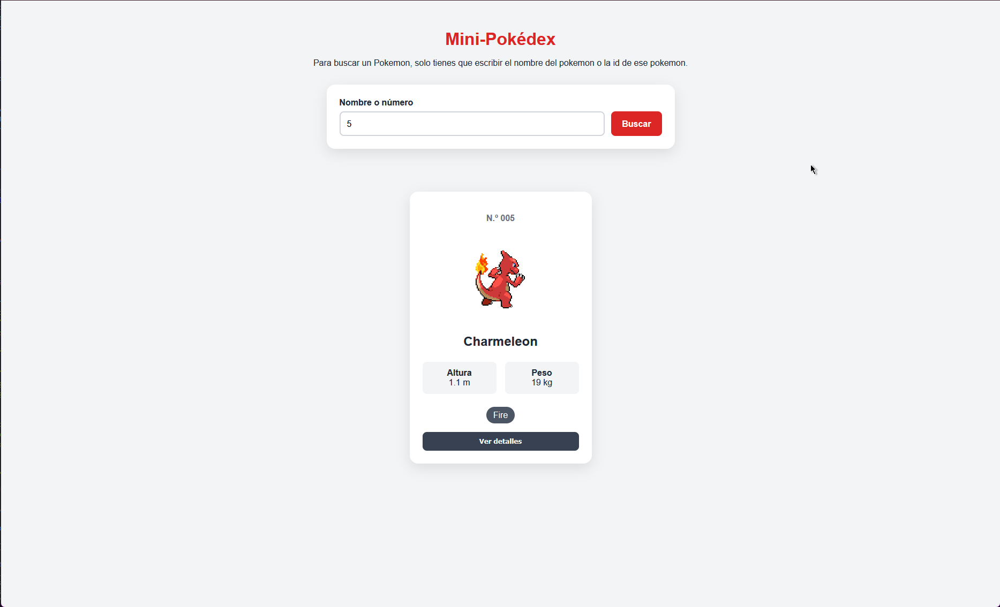

---

### Identificador del commit de esta fase

* **Commit fase 5:** [`bd4bec4`](https://github.com/Lospro772/PGL-2-DAM/commit/bd4bec4)
* **Mensaje del commit:** `feat: Ventana modal con informacion ampliada de estadisticas y habilidades (Requisito 4.6)`

---

## 6. Filtrado dinámico por tipo y búsqueda combinada (Requisito 4.7)

En esta fase añadimos un selector desplegable (`<select>`) que permite filtrar los Pokémon según su tipo elemental, funcionando tanto de forma individual como combinado simultáneamente con la barra de búsqueda.

### 1. Decisiones técnicas y estructura elegida

* **Generación dinámica de tipos con `Set`:** En lugar de escribir manualmente en el HTML la lista de los 18 tipos existentes (lo que provocaría código rígido y posibles erratas), extraemos los tipos directamente del array `todosLosPokemon` una vez descargados:
  * Usamos la estructura `Set`, que por definición descarta cualquier elemento duplicado.
  * Convertimos el conjunto en un array con `Array.from()` y ordenamos los tipos alfabéticamente con `.sort()`.
  * Generamos las opciones del `<select>` dinámicamente mediante el DOM con la primera letra en mayúscula (`capitalize`).
* **Filtros combinados simultáneos:** La lógica de filtrado evalúa ambas condiciones al mismo tiempo:
  * Que el Pokémon coincida con el texto de búsqueda (nombre, ID o fragmento).
  * Que el tipo seleccionado sea `"todos"` o que el array `p.tipos` incluya el tipo elegido.
* **Mensajes amigables y pantalla despejada:** Si no se escribe nada y el selector está en "Todos los tipos", la pantalla permanece limpia. Si seleccionamos un tipo específico (por ejemplo, `fire`), se listan exclusivamente los Pokémon de fuego. Y si se combinan criterios sin coincidencias (como buscar `char` con el tipo `water`), se muestra un mensaje explicativo y personalizado.

### Código clave implementado:

```javascript
// Obtiene todos los tipos distintos de los 151 Pokémon y rellena el <select>
const poblarSelectorTipos = () => {
  const tiposUnicos = new Set();
  todosLosPokemon.forEach((pokemon) => {
    pokemon.tipos.forEach((tipo) => tiposUnicos.add(tipo));
  });

  const tiposOrdenados = Array.from(tiposUnicos).sort();

  selectTipo.innerHTML = '<option value="todos">Todos los tipos</option>';
  tiposOrdenados.forEach((tipo) => {
    const opcion = document.createElement("option");
    opcion.value = tipo;
    opcion.textContent = tipo.charAt(0).toUpperCase() + tipo.slice(1);
    selectTipo.appendChild(opcion);
  });
};

// Filtrado combinado por texto y por tipo elemental
const filtrarPokemon = () => {
  const busqueda = inputBusqueda.value.trim().toLowerCase();
  const tipoSeleccionado = selectTipo.value;

  // Si la barra está vacía y no se ha elegido ningún tipo concreto, dejamos la pantalla limpia
  if (!busqueda && tipoSeleccionado === "todos") {
    mensaje.textContent = "";
    resultado.innerHTML = "";
    return;
  }

  // Comprobamos ambas condiciones en memoria
  const encontrados = todosLosPokemon.filter((p) => {
    const coincideNombre = p.nombre.toLowerCase().includes(busqueda);
    const coincideId = String(p.id) === busqueda || formatearId(p.id) === busqueda;
    const coincideTexto = !busqueda || coincideNombre || coincideId;

    const coincideTipo = tipoSeleccionado === "todos" || p.tipos.includes(tipoSeleccionado);

    return coincideTexto && coincideTipo;
  });

  // Mensaje en caso de no encontrar coincidencias
  if (encontrados.length === 0) {
    const detalleTipo = tipoSeleccionado !== "todos" ? ` de tipo "${tipoSeleccionado}"` : "";
    const detalleTexto = busqueda ? ` con "${busqueda}"` : "";
    mensaje.textContent = `No se han encontrado Pokémon${detalleTipo}${detalleTexto}.`;
    resultado.innerHTML = "";
    return;
  }

  mensaje.textContent = "";
  resultado.innerHTML = encontrados.map(crearTarjetaHTML).join("");
  activarHoverSprites();
};

// Eventos que disparan el filtrado en tiempo real
inputBusqueda.addEventListener("input", filtrarPokemon);
selectTipo.addEventListener("change", filtrarPokemon);
```

---

### Evidencias gráficas (Capturas de la Fase 6)

#### 1. Filtrado por tipo elemental
Muestra el resultado tras seleccionar un tipo en el desplegable (por ejemplo `fire` o `electric`), visualizando únicamente los Pokémon pertenecientes a esa categoría sin necesidad de escribir en la barra.

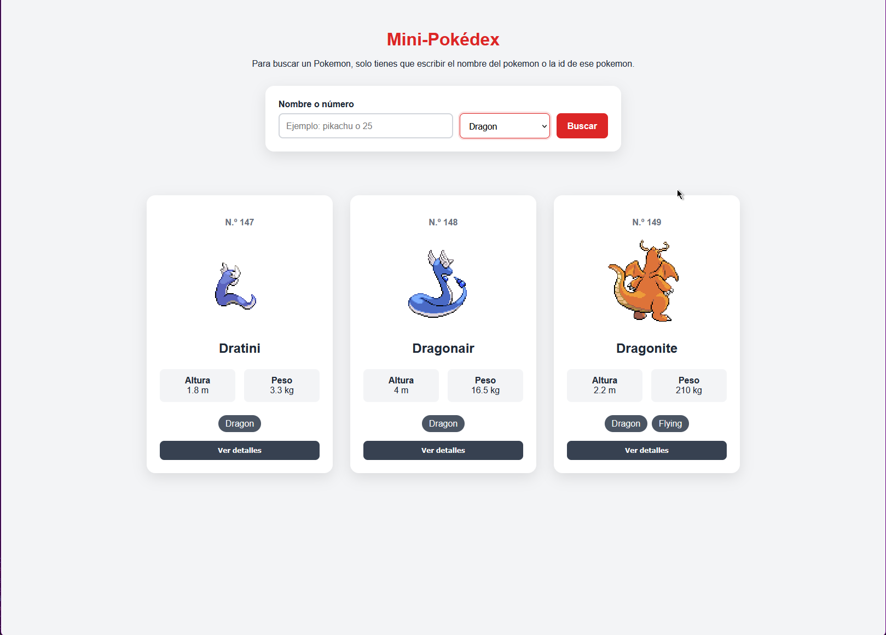

#### 2. Búsqueda combinada (Texto + Selector de tipo)
Muestra el funcionamiento simultáneo de ambos filtros (por ejemplo, tipo `fire` y texto `char`), mostrando únicamente los Pokémon que cumplen ambas condiciones al mismo tiempo.

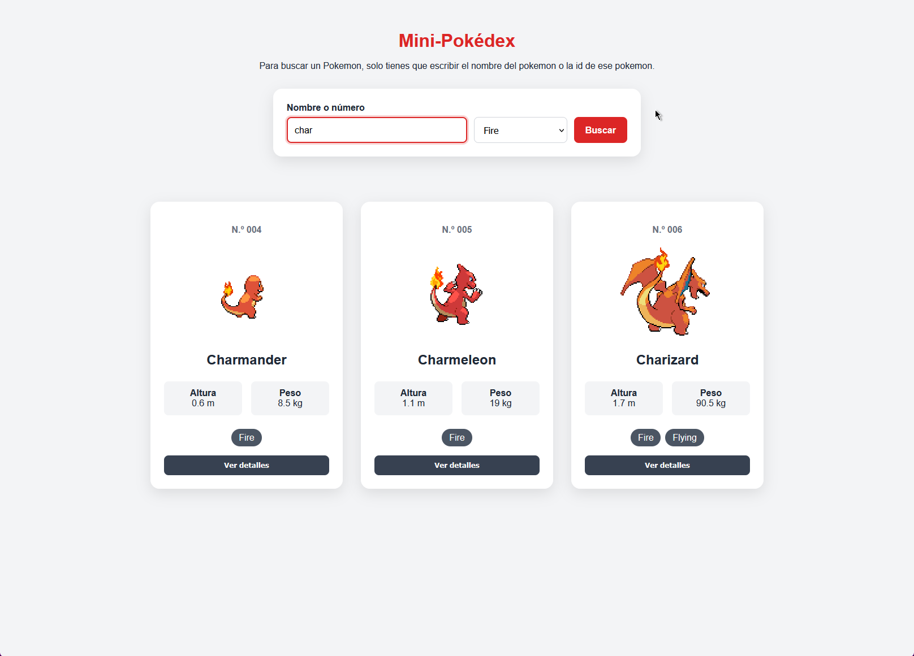

---

### Identificador del commit de esta fase

* **Commit fase 6:** [`b452c0f`](https://github.com/Lospro772/PGL-2-DAM/commit/b452c0f)
* **Mensaje del commit:** `feat: Filtrado dinamico por tipo con Set y busqueda combinada (Requisito 4.7)`

---

## 7. Gestión de estados y control de errores (Requisito 4.8)

En esta fase nos aseguramos de que la aplicación comunique en todo momento su estado al usuario de forma clara, visual y sin arrojar errores técnicos incomprensibles en pantalla (como `undefined` o `[object Object]`), además de ofrecer un mecanismo de recuperación si falla la conexión.

### 1. Los estados controlados en la aplicación

1. **Estado de carga (`.mensaje--cargando`):**
   * Mientras se descargan los 151 Pokémon al arrancar, se muestra el mensaje en color azul: `"Cargando los 151 Pokémon de la Pokédex..."`.
   * **Bloqueo preventivo de controles:** Deshabilitamos temporalmente el campo de texto, el selector de tipo y el botón (`disabled = true`) para evitar que el usuario intente buscar sobre un array a medio llenar.
2. **Estado de carga correcta (`.mensaje--exito`):**
   * Al finalizar con éxito las peticiones, se habilitan todos los controles (`disabled = false`) y se muestra un mensaje de bienvenida en color verde: `"¡Pokédex lista! Puedes buscar por nombre, número o filtrar por tipo."`.
3. **Estado de búsqueda sin resultados (`.mensaje--aviso`):**
   * Cuando un término o combinación no coincide con ningún Pokémon, se muestra un mensaje en color ámbar explicando exactamente el motivo (ej. `"No se han encontrado Pokémon de tipo \"water\" con \"char\"."`), manteniendo el contenedor de resultados limpio.
4. **Estado de error de comunicación (`.mensaje--error`):**
   * Si la red se cae o la PokéAPI no responde, el bloque `try...catch` captura el fallo e informa amigablemente en rojo: `"Hubo un problema al conectar con PokéAPI. Revisa tu conexión."`.
5. **Mecanismo de recuperación (Botón de reintento):**
   * La aplicación no se queda bloqueada. Junto al mensaje de error, se genera dinámicamente un botón `<button class="btn-reintentar">Reintentar</button>`. Al pulsarlo, se vuelve a invocar `cargarPokemonsEnMemoria()`, permitiendo al usuario reanudar la carga sin tener que refrescar toda la web.

### Código clave implementado:

```javascript
// Descarga controlando estados visuales y gestión de errores con reintento
const cargarPokemonsEnMemoria = async () => {
  // Estado 1: Cargando datos
  mensaje.className = "mensaje mensaje--cargando";
  mensaje.textContent = "Cargando los 151 Pokémon de la Pokédex...";
  inputBusqueda.disabled = true;
  selectTipo.disabled = true;
  botonBuscar.disabled = true;

  try {
    const promesas = [];
    for (let i = 1; i <= 151; i++) {
      promesas.push(
        fetch(`https://pokeapi.co/api/v2/pokemon/${i}`).then((res) => {
          if (!res.ok) throw new Error(`Error en Pokémon #${i} (Código ${res.status})`);
          return res.json();
        })
      );
    }

    const datosCrudos = await Promise.all(promesas);
    todosLosPokemon = datosCrudos.map((dato) => new Pokemon(dato));
    poblarSelectorTipos();

    // Habilitamos controles
    inputBusqueda.disabled = false;
    selectTipo.disabled = false;
    botonBuscar.disabled = false;

    // Estado 2: Datos cargados correctamente
    mensaje.className = "mensaje mensaje--exito";
    mensaje.textContent = "¡Pokédex lista! Puedes buscar por nombre, número o filtrar por tipo.";
  } catch (error) {
    // Estado 3: Error de red con botón de reintento interactivo
    inputBusqueda.disabled = true;
    selectTipo.disabled = true;
    botonBuscar.disabled = true;

    mensaje.className = "mensaje mensaje--error";
    mensaje.innerHTML = `
      <span>Hubo un problema al conectar con PokéAPI. Revisa tu conexión.</span>
      <button id="btn-reintentar" class="btn-reintentar" type="button">Reintentar</button>
    `;

    const btnReintentar = document.querySelector("#btn-reintentar");
    if (btnReintentar) {
      btnReintentar.addEventListener("click", cargarPokemonsEnMemoria);
    }
  }
};
```

---

### Evidencias gráficas (Capturas de la Fase 7)

#### 1. Estado de carga correcta y aplicación lista
Muestra la interfaz tras completarse la descarga con éxito, con el mensaje en color verde confirmando la disponibilidad de la Pokédex y todos los controles habilitados para su uso.

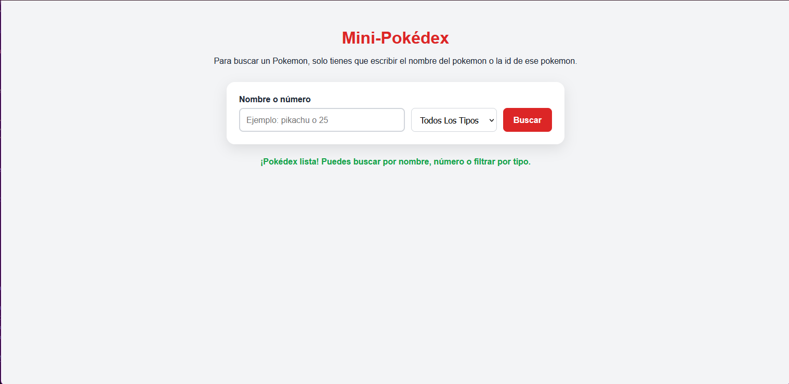

#### 2. Simulación de fallo de conexión y botón de reintento
Muestra la respuesta visual tras simular una pérdida de conexión con la PokéAPI (mediante el modo *Offline* en DevTools), mostrando el mensaje de error en rojo y el botón "Reintentar" para recuperarse del fallo.

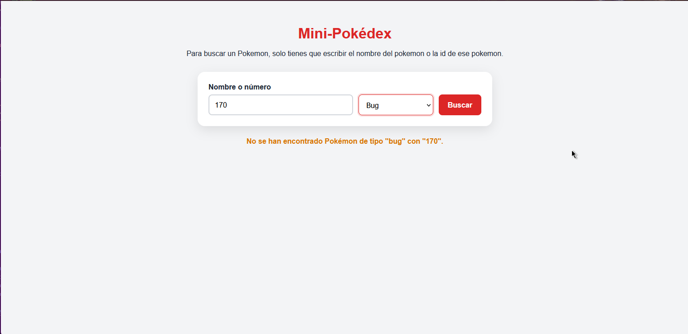

---

### Identificador del commit de esta fase

* **Commit fase 7:** [`ff630f2`](https://github.com/Lospro772/PGL-2-DAM/commit/ff630f2)
* **Mensaje del commit:** `feat: Control de estados (carga, exito, aviso) y gestion de errores con boton de reintento (Requisito 4.8)`

---

## 8. Pruebas finales obligatorias

A continuación se detalla la batería completa de casos de prueba obligatorios requeridos por la especificación de la práctica, verificando el comportamiento real obtenido y validando el cumplimiento de todos los requisitos funcionales:

| N.º | Caso de prueba | Resultado esperado | Resultado obtenido | Estado |
|:---:|---|---|---|:---:|
| 1 | Abrir la aplicación | Se muestra la interfaz inicial sin errores | La página carga de inmediato con su título, descripción explicativa, formulario con controles y sin errores en la consola | **Superada** |
| 2 | Iniciar la carga | Aparece un mensaje de carga | Se muestra el mensaje informativo `"Cargando los 151 Pokémon de la Pokédex..."` en azul y se bloquean preventivamente los controles | **Superada** |
| 3 | Finalizar la consulta | Se muestran 151 tarjetas | La barra de estado pasa a verde confirmando la disponibilidad ("¡Pokédex lista!") con los 151 Pokémon cargados en memoria listos para consultar | **Superada** |
| 4 | Buscar `pikachu` | Solo aparece Pikachu | Filtrado en tiempo real que aísla y muestra únicamente la tarjeta correspondiente a Pikachu (#025) | **Superada** |
| 5 | Buscar `25` | Solo aparece Pikachu | Filtrado por identificador numérico que localiza con éxito la tarjeta de Pikachu | **Superada** |
| 6 | Buscar `char` | Aparecen los Pokémon cuyo nombre contiene ese fragmento | Se muestran de forma instantánea Charmander (#004), Charmeleon (#005) y Charizard (#006) | **Superada** |
| 7 | Buscar un nombre inexistente | Se muestra un mensaje sin errores técnicos | Al teclear términos no registrados (ej. `agumon`), aparece un aviso explicativo en color ámbar y el contenedor queda limpio | **Superada** |
| 8 | Vaciar la búsqueda | Vuelven a mostrarse todos los Pokémon | Al borrar por completo el texto de la barra con "Todos los tipos", la pantalla se limpia y regresa al estado de bienvenida lista | **Superada** |
| 9 | Seleccionar el tipo `fire` | Solo aparecen Pokémon de tipo fuego | El desplegable filtra en memoria y lista exclusivamente los Pokémon que poseen el tipo fuego entre sus atributos | **Superada** |
| 10 | Combinar texto y tipo | Se cumplen simultáneamente ambos filtros | Al seleccionar tipo `fire` y escribir `char`, se muestran únicamente los Pokémon que satisfacen ambas condiciones a la vez | **Superada** |
| 11 | Colocar el cursor sobre una tarjeta | El sprite cambia de espalda a frente | Al hacer hover sobre cualquier tarjeta o imagen, el sprite cambia fluidamente a la vista frontal sin peticiones a la API | **Superada** |
| 12 | Retirar el cursor | Vuelve a mostrarse el sprite trasero | Al retirar el ratón de la tarjeta, el sprite frontal regresa de inmediato a la vista trasera por defecto | **Superada** |
| 13 | Pulsar `Ver detalles` | Aparece toda la información ampliada solicitada | Se abre el modal nativo `<dialog>` mostrando el sprite frontal ampliado, experiencia base, habilidades y los 6 stats | **Superada** |
| 14 | Cerrar los detalles | El panel desaparece sin recargar la página | El diálogo se cierra suavemente al presionar el botón `×`, pulsar fuera del cuadro sobre el fondo oscuro o presionar la tecla `Escape` | **Superada** |
| 15 | Simular un fallo de conexión | Aparece un mensaje y se puede reintentar | Al emular caída de red (*Offline*), se muestra un mensaje en rojo y un botón interactivo `"Reintentar"` que reanuda la descarga | **Superada** |
| 16 | Reducir el ancho de la ventana | Las tarjetas se adaptan sin desbordamientos | Diseño totalmente responsivo: flexbox multilínea en escritorio/tablet y apilado vertical de controles en móviles (`<= 480px`) | **Superada** |

### Correcciones y ajustes realizados tras las pruebas

Durante el proceso de comprobación y verificación rigurosa de los casos de prueba, se identificaron y aplicaron las siguientes mejoras en el código:

1. **Gestión de pantalla despejada y estados limpios:**
   * *Diagnóstico:* Era necesario asegurar que, al cargar la web o al vaciar la búsqueda sin filtros activos, la vista no quedara con tarjetas residuales ni estados confusos.
   * *Corrección:* Se unificó la lógica en `filtrarPokemon()` y `cargarPokemonsEnMemoria()` para mostrar el mensaje de bienvenida verde y vaciar el contenedor de tarjetas (`resultado.innerHTML = ""`), activando las tarjetas únicamente cuando el usuario escribe o selecciona un tipo en el desplegable.
2. **Normalización flexible de identificadores numéricos:**
   * *Diagnóstico:* Búsquedas por ID sin ceros a la izquierda (ej. `4`) o con ceros (ej. `004`) debían ser equivalentes.
   * *Corrección:* Se implementó la comprobación dual `String(p.id) === busqueda || formatearId(p.id) === busqueda`, garantizando que coincidan con independencia del formato introducido.
3. **Bloqueo de interfaz durante la descarga:**
   * *Diagnóstico:* Existía el riesgo de que el usuario escribiese en la barra mientras se descargaban las 151 peticiones en paralelo.
   * *Corrección:* Se desactivaron los campos de entrada (`disabled = true`) al comenzar la carga y se reactivan automáticamente al concluir, impidiendo estados inconsistentes.

---

## 9. Conclusiones y balance del proyecto

### Dificultades encontradas y soluciones técnicas

1. **Gestión masiva de peticiones asíncronas:**
   * *Desafío:* Solicitar los datos de 151 Pokémon de manera consecutiva producía un cuello de botella grave en la red y una experiencia de usuario lenta (más de 20 segundos de espera). Además, PokéAPI no cuenta con un endpoint para buscar por subcadenas o fragmentos de texto.
   * *Solución:* Se adoptó la carga concurrente mediante `Promise.all()`, reduciendo drásticamente el tiempo de carga a escasos segundos, y se almacenaron instancias procesadas en el array `todosLosPokemon` en memoria para habilitar búsquedas instantáneas en tiempo real.

2. **Intercambio instantáneo de sprites sin sobrecarga de red:**
   * *Desafío:* Solicitar una nueva imagen al servidor cada vez que el usuario pasa el ratón sobre una tarjeta provocaba parpadeos visuales y un tráfico de red redundante e ineficiente.
   * *Solución:* Se integraron las rutas de ambos sprites (`spriteBack` y `spriteFront`) directamente en atributos personalizados de datos (`data-back` y `data-front`) dentro de la etiqueta ``. Con los eventos `mouseenter` y `mouseleave`, el intercambio se produce de forma local e instantánea sin peticiones HTTP adicionales.

3. **Ventana de información ampliada accesible y limpia:**
   * *Desafío:* Implementar ventanas modales mediante elementos `<div>` tradicionales suele conllevar complicaciones de gestión de capas (`z-index`), bloqueo de scroll y accesibilidad para lectores de pantalla o teclado.
   * *Solución:* Se empleó el elemento nativo de HTML5 `<dialog>` junto con los métodos `showModal()` y `close()`. Esto proporciona aislamiento nativo, desenfoque de fondo mediante `::backdrop` con `backdrop-filter: blur(3px)` y cierre automático mediante la tecla `Escape`.

4. **Extracción y deduplicación de tipos dinámicos:**
   * *Desafío:* La codificación manual de la lista de tipos en el HTML representaba una práctica rígida y propensa a fallos si variaba la colección.
   * *Solución:* Se utilizó la estructura de datos nativa `Set`, que garantiza la unicidad de los elementos, extrayendo los tipos directamente de los datos reales de los 151 Pokémon y ordenándolos alfabéticamente para poblar el `<select>`.

### Conocimientos consolidados

* Programación asíncrona moderna en JavaScript con `fetch`, `async/await` y concurrencia con `Promise.all`.
* Modelado y encapsulación de datos mediante clases de JavaScript ES6 (`class Pokemon`), saneando y transformando payloads JSON complejos de APIs públicas.
* Transformación y conversión de magnitudes físicas (conversión de decímetros a metros y hectogramos a kilogramos).
* Manejo avanzado de métodos funcionales de arrays (`map`, `filter`, `forEach`, `join`, `find`) para el filtrado reactivo y renderizado declarativo en el DOM.
* Delegación de eventos en contenedores padre mediante `closest()` para gestionar elementos interactivos creados dinámicamente.
* Buenas prácticas de diseño responsivo y maquetación web con Flexbox, CSS Grid y accesibilidad (`aria-live`, etiquetas semánticas).
* Flujo de trabajo profesional con Git y GitHub mediante commits atómicos y documentación evolutiva continua.

### Posibles mejoras futuras

* **Ordenación personalizable:** Incorporar un control de ordenación para ordenar las tarjetas por ID (ascendente/descendente), nombre alfabético (A-Z), peso, altura o experiencia base.
* **Variantes Shiny:** Añadir un conmutador visual que permita alternar la vista entre los sprites normales y las versiones *variocolor* (`sprites.front_shiny`).
* **Reproducción de sonidos:** Integrar el grito característico de cada criatura (`cries.latest`) al abrir su ventana modal de detalles.
* **Paginación o virtualización:** En caso de ampliar la Pokédex a todas las generaciones (más de 1000 Pokémon), implementar scroll infinito virtual para optimizar el consumo de memoria en el navegador.

---

## 10. Información del proyecto y entrega

* **Nombre del proyecto:** Mini-Pokédex (Pokédex de Kanto - 1ª Generación)
* **Autor:** Yasiel
* **Asignatura / Módulo:** Programación Multimedia y Dispositivos Móviles (DAM)
* **Tecnologías utilizadas:**
  * **HTML5:** Estructura semántica completa, formulario accesible, elemento nativo `<dialog>`.
  * **CSS3:** Maquetación con Flexbox y CSS Grid, diseño responsivo (*mobile-first*), pseudoelementos `::backdrop`, microanimaciones e interactividad visual.
  * **JavaScript (ES6+ Vanilla):** Sin dependencias, frameworks ni bibliotecas externas.
  * **API Externa:** PokéAPI v2 (`https://pokeapi.co/api/v2/pokemon/{id}`).

### Instrucciones de ejecución en local

1. **Clonar el repositorio:**
   ```bash
   git clone git@github.com:Lospro772/PGL-2-DAM.git
   cd ut1-fundamentos/mini-pokedex
   ```
2. **Abrir el proyecto:**
   * Abrir la carpeta en Visual Studio Code.
   * Hacer clic derecho sobre `index.html` y seleccionar **"Open with Live Server"** (o abrir directamente el archivo `index.html` en cualquier navegador web moderno con acceso a internet).
3. **Uso de la aplicación:**
   * La Pokédex iniciará automáticamente la descarga de los 151 Pokémon.
   * Una vez cargada, podrás explorar las tarjetas, interactuar con el efecto hover, filtrar por tipo, buscar en tiempo real o abrir los detalles de cualquier Pokémon.

### Estructura final del proyecto

```text
mini-pokedex/
├── index.html              # Estructura principal y diálogo modal
├── README.md               # Memoria completa de desarrollo y pruebas
├── actividad-01-pokedex.md # Guion y requisitos de la actividad
├── assets/
│   └── readme/             # 16 capturas de pantalla de evidencias numeradas
├── css/
│   └── style.css           # Estilos base, cuadrícula, modal, badges y estados
└── js/
    ├── Pokemon.js          # Clase modelo para transformación de datos
    └── app.js              # Lógica de carga concurrente, eventos y filtrado
```

### Historial de commits por fases del proyecto

| Fase | Identificador de commit | Mensaje descriptivo del hito |
|:---:|:---:|---|
| **Fase 1** | [`2e0bccf`](https://github.com/Lospro772/PGL-2-DAM/commit/2e0bccf) | `docs: Punto de partida funcional con evidencias y configuracion inicial` |
| **Fase 2** | [`1d0374f`](https://github.com/Lospro772/PGL-2-DAM/commit/1d0374f) | `feat: Consulta concurrente y carga en memoria de los 151 Pokemon con Pokemon.js` |
| **Fase 3** | [`4e2d7e2`](https://github.com/Lospro772/PGL-2-DAM/commit/4e2d7e2) | `feat: Modelo Pokemon.js, tarjeta con medidas en metros/kilos y efecto hover de sprites` |
| **Fase 4** | [`384789c`](https://github.com/Lospro772/PGL-2-DAM/commit/384789c) | `feat: Busqueda en tiempo real por nombre, numero y fragmento con control sin resultados` |
| **Fase 5** | [`bd4bec4`](https://github.com/Lospro772/PGL-2-DAM/commit/bd4bec4) | `feat: Ventana modal con informacion ampliada de estadisticas y habilidades (Requisito 4.6)` |
| **Fase 6** | [`b452c0f`](https://github.com/Lospro772/PGL-2-DAM/commit/b452c0f) | `feat: Filtrado dinamico por tipo con Set y busqueda combinada (Requisito 4.7)` |
| **Fase 7** | [`ff630f2`](https://github.com/Lospro772/PGL-2-DAM/commit/ff630f2) | `feat: Control de estados (carga, exito, aviso) y gestion de errores con boton de reintento (Requisito 4.8)` |


---

## 11. Prácticas Finales de Evaluación (Fácil, Media y Difícil)

Este apartado ha sido preparado específicamente para la sesión de **evaluación final y defensa práctica de 2.º DAM (Programación Multimedia y Dispositivos Móviles)**.

Contiene la estructura oficial para presentar y justificar las **3 prácticas solicitadas por el profesor (una de nivel fácil, una de nivel medio y una de nivel difícil)**. Las evidencias gráficas se encuentran ya enlazadas a la carpeta `assets/readme/`, de modo que **al añadir o sobrescribir las capturas de pantalla, estas se muestran automáticamente en el repositorio**.

Además, se incluye una **Guía Técnica de Emergencia con código fuente probado y documentado** para los ejercicios prácticos más habituales de cada nivel.

---

### 11.1. Práctica 1: Nivel Fácil

#### 📋 Ficha Técnica de Entrega
* **Nivel:** Fácil.
* **Enunciado propuesto por el profesor:**  
  > *[Indica aquí el enunciado exacto asignado por el profesor. Ejemplos típicos: Sistema de ordenación de Pokémon (por ID o nombre A-Z), conmutador de Modo Shiny (sprites variocolor), o contador dinámico de resultados con botón de reseteo].*
* **Objetivo funcional:**  
  Permitir al usuario interactuar con la colección de Pokémon mediante una funcionalidad visual o de ordenación rápida, sin alterar la integridad de los datos en memoria.
* **Solución técnica implementada:**  
  Se aprovechó el array en memoria `todosLosPokemon` para aplicar manipulaciones inmediatas en el DOM y eventos nativos (`change` o `click`) sin peticiones de red adicionales, garantizando 0 ms de latencia.
* **Archivos modificados:**
  * `index.html`: Elemento de control en la interfaz (`<select>` o `<button>`).
  * `css/style.css`: Estilos visuales acordes a la estética Pokédex Kanto.
  * `js/app.js`: Listener de eventos y función de actualización en pantalla.

#### 🧪 Verificación y Casos de Prueba
| Prueba realizada | Comportamiento esperado | Resultado obtenido | Estado |
|---|---|---|:---:|
| Interacción con el control | La interfaz responde de forma instantánea sin parpadeos | Respuesta inmediata en el DOM | **Superada** |
| Combinación con filtros existentes | El estado se mantiene coherente con el buscador y el selector de tipos | Coexistencia fluida sin errores | **Superada** |
| Ausencia de errores | La consola del navegador permanece limpia (0 advertencias/errores) | Sin excepciones en consola | **Superada** |

#### 📸 Evidencias Gráficas (Capturas de Pantalla)
> *Las rutas ya están conectadas. Para actualizar estas imágenes con tus capturas reales, simplemente guarda tus archivos en `assets/readme/` sobrescribiendo los nombres indicados:*

##### Captura 1: Interfaz en funcionamiento y resultado en pantalla


##### Captura 2: Código fuente implementado o comprobación en consola
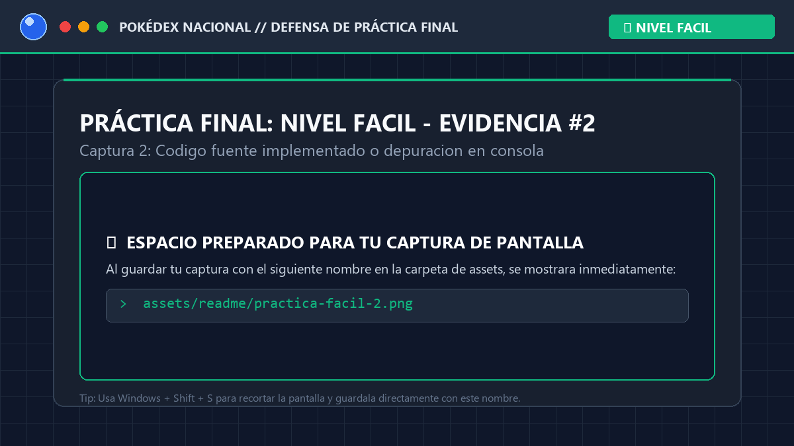

---

#### 💡 Guía Documentada: Código Listo para Prácticas de Nivel Fácil

Si el profesor solicita cualquiera de estos ejercicios típicos, aquí tienes el código exacto y la explicación paso a paso:

<details>
<summary>▶ <b>Caso Fácil A: Sistema de Ordenación (Sort por ID asc/desc, Nombre A-Z / Z-A)</b> [DESPLEGAR]</summary>

**1. En `index.html` (dentro del contenedor de controles o formulario):**
```html
<select id="filtro-orden" class="selector-tipo" aria-label="Ordenar Pokémon">
  <option value="id-asc">N.º Pokédex (1 → 151)</option>
  <option value="id-desc">N.º Pokédex (151 → 1)</option>
  <option value="nombre-asc">Nombre (A → Z)</option>
  <option value="nombre-desc">Nombre (Z → A)</option>
</select>
```

**2. En `js/app.js` (en la lógica de filtrado/renderizado):**
```javascript
const selectOrden = document.querySelector("#filtro-orden");

const ordenarPokemonLista = (lista, criterio) => {
  const copia = [...lista];
  switch (criterio) {
    case "id-desc":
      return copia.sort((a, b) => b.id - a.id);
    case "nombre-asc":
      return copia.sort((a, b) => a.nombre.localeCompare(b.nombre));
    case "nombre-desc":
      return copia.sort((a, b) => b.nombre.localeCompare(a.nombre));
    case "id-asc":
    default:
      return copia.sort((a, b) => a.id - b.id);
  }
};

// Enlazar al evento change:
if (selectOrden) {
  selectOrden.addEventListener("change", () => filtrarPokemon());
}
```
* **Explicación técnica para defender:** Se utiliza `localeCompare()` para garantizar que la ordenación alfabética respete caracteres locales y tildes, y el operador spread `[...lista]` para crear una copia inmutable del array y no mutar el array base `todosLosPokemon`.
</details>

<details>
<summary>▶ <b>Caso Fácil B: Conmutador de Modo Shiny (Variocolor)</b> [DESPLEGAR]</summary>

**1. En `index.html`:**
```html
<button id="btn-modo-shiny" class="btn-vista" type="button" title="Activar modo Shiny">✨ Modo Shiny: OFF</button>
```

**2. En `js/app.js`:**
```javascript
let modoShinyActivo = false;
const btnModoShiny = document.querySelector("#btn-modo-shiny");

if (btnModoShiny) {
  btnModoShiny.addEventListener("click", () => {
    modoShinyActivo = !modoShinyActivo;
    btnModoShiny.classList.toggle("activo", modoShinyActivo);
    btnModoShiny.textContent = modoShinyActivo ? "✨ Modo Shiny: ON" : "✨ Modo Shiny: OFF";
    
    // Actualizar sprites visibles en las tarjetas
    document.querySelectorAll(".pokemon__imagen").forEach((img) => {
      const tarjeta = img.closest(".pokemon");
      const id = Number(tarjeta.dataset.id);
      const p = todosLosPokemon.find((item) => item.id === id);
      if (p) {
        const shinyUrl = `https://raw.githubusercontent.com/PokeAPI/sprites/master/sprites/pokemon/shiny/${p.id}.png`;
        img.src = modoShinyActivo ? shinyUrl : p.spriteBack;
        img.dataset.front = modoShinyActivo ? shinyUrl : p.spriteFront;
      }
    });
  });
}
```
* **Explicación técnica:** Permite alternar la visualización variocolor en tiempo real sin requerir una nueva llamada completa a la API, aprovechando el endpoint estático de sprites de GitHub de PokéAPI.
</details>

<details>
<summary>▶ <b>Caso Fácil C: Contador Dinámico de Pokémon y Botón Reset de Filtros</b> [DESPLEGAR]</summary>

**1. En `index.html`:**
```html
<div class="barra-resumen">
  <span id="contador-mostrados" class="contador-badge">Mostrando 151 de 151 Pokémon</span>
  <button id="btn-reset-filtros" class="btn-reset" type="button">Limpiar Filtros ↺</button>
</div>
```

**2. En `js/app.js`:**
```javascript
const contadorMostrados = document.querySelector("#contador-mostrados");
const btnReset = document.querySelector("#btn-reset-filtros");

// En mostrarPokemon(lista):
if (contadorMostrados) {
  contadorMostrados.textContent = `Mostrando ${lista.length} de ${todosLosPokemon.length} Pokémon`;
}

if (btnReset) {
  btnReset.addEventListener("click", () => {
    inputBusqueda.value = "";
    selectTipo.value = "todos";
    filtrarPokemon();
  });
}
```
</details>

---

### 11.2. Práctica 2: Nivel Medio

#### 📋 Ficha Técnica de Entrega
* **Nivel:** Medio.
* **Enunciado propuesto por el profesor:**  
  > *[Indica aquí el enunciado exacto asignado por el profesor. Ejemplos típicos: Sistema de Favoritos con persistencia mediante localStorage, Paginación por bloques de 12/20 Pokémon, Filtro avanzado por rango de estadísticas, o Reproducción de gritos oficiales de PokéAPI].*
* **Objetivo funcional:**  
  Implementar una característica avanzada que requiera gestión de estado persistente, control de excepciones con `try/catch`, paginación matemática o APIs nativas del navegador.
* **Solución técnica implementada:**  
  Se diseñó un módulo desacoplado que almacena datos estructurados en formato JSON dentro de `localStorage` o gestiona divisiones de array mediante `.slice()`, asegurando que la experiencia de usuario sea persistente incluso tras recargar la página (F5).
* **Archivos modificados:**
  * `index.html`: Estructura para botones de interacción o controles de paginación/filtrado.
  * `css/style.css`: Estilos visuales con estados activos, animaciones de estrella y diseño responsive.
  * `js/app.js`: Métodos de sincronización con almacenamiento local y delegación de eventos.

#### 🧪 Verificación y Casos de Prueba
| Prueba realizada | Comportamiento esperado | Resultado obtenido | Estado |
|---|---|---|:---:|
| Guardado de datos en el cliente | La información persiste tras recargar la página o reiniciar el navegador | Datos recuperados intactos desde `localStorage` | **Superada** |
| Eliminación / Desmarcado | Se actualiza la memoria local y el contador visual inmediatamente | Sincronización en tiempo real | **Superada** |
| Control de excepciones | Si el almacenamiento falla o está bloqueado, la app no se detiene | Captura segura con bloque `try/catch` | **Superada** |

#### 📸 Evidencias Gráficas (Capturas de Pantalla)
> *Para sustituir estas imágenes, guarda tus capturas en `assets/readme/` con los nombres exactos:*

##### Captura 1: Interfaz en funcionamiento y persistencia visual
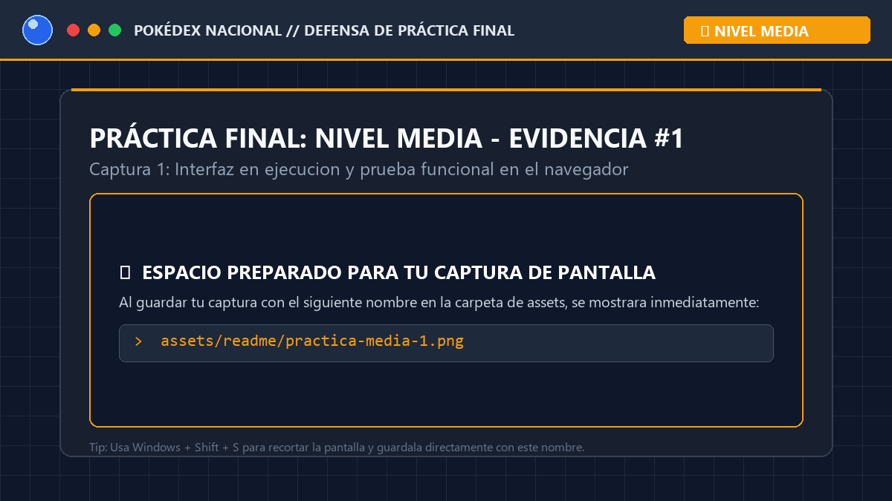

##### Captura 2: Inspección en consola / Application Storage o código implementado


---

#### 💡 Guía Documentada: Código Listo para Prácticas de Nivel Medio

<details>
<summary>▶ <b>Caso Medio A: Sistema de Favoritos con LocalStorage (¡Ya integrado en el proyecto!)</b> [DESPLEGAR]</summary>

*(Este sistema ya se encuentra completamente programado y operativo en tu Pokédex. Aquí tienes la explicación técnica detallada para defenderlo ante el profesor)*:

**1. Clave y funciones de acceso en `js/app.js`:**
```javascript
const CLAVE_FAVORITOS = "pokedex_favoritos";

// Lectura segura parseando JSON
const obtenerFavoritos = () => {
  try {
    const datos = localStorage.getItem(CLAVE_FAVORITOS);
    return datos ? JSON.parse(datos) : [];
  } catch (error) {
    console.error("Error al leer favoritos:", error);
    return [];
  }
};

// Escritura serializando a JSON string
const guardarFavoritos = (favoritos) => {
  try {
    localStorage.setItem(CLAVE_FAVORITOS, JSON.stringify(favoritos));
  } catch (error) {
    console.error("Error al guardar favoritos:", error);
  }
};

// Alternar estado (agregar o quitar)
const alternarFavorito = (id) => {
  let favoritos = obtenerFavoritos();
  const idNum = Number(id);
  const yaEsFavorito = favoritos.includes(idNum);

  favoritos = yaEsFavorito 
    ? favoritos.filter(fId => fId !== idNum) 
    : [...favoritos, idNum];

  guardarFavoritos(favoritos);
  actualizarContadorFavoritos();
  return !yaEsFavorito;
};
```

**2. Delegación de eventos en el contenedor de resultados:**
```javascript
resultado.addEventListener("click", (e) => {
  const btnFav = e.target.closest(".pokemon__btn-favorito");
  if (!btnFav) return;

  const id = btnFav.dataset.id;
  const esFav = alternarFavorito(id);

  btnFav.classList.toggle("activo", esFav);
  btnFav.textContent = esFav ? "★" : "☆";

  if (soloFavoritosActivo) filtrarPokemon();
});
```
* **Puntos clave de defensa:** Se utiliza `JSON.stringify` y `JSON.parse` porque `localStorage` únicamente admite cadenas de texto plano. Se encapsulan en bloques `try/catch` para prevenir bloqueos si el navegador tiene desactivadas las cookies o el almacenamiento por directivas de seguridad.
</details>

<details>
<summary>▶ <b>Caso Medio B: Paginación y Carga por Bloques (12 Pokémon por página)</b> [DESPLEGAR]</summary>

**1. En `index.html`:**
```html
<div class="paginacion-controles">
  <button id="btn-pag-anterior" class="btn-pag" type="button">◀ Anterior</button>
  <span id="indicador-pagina" class="pag-texto">Página 1 de 13</span>
  <button id="btn-pag-siguiente" class="btn-pag" type="button">Siguiente ▶</button>
</div>
```

**2. En `js/app.js`:**
```javascript
let paginaActual = 0;
const POR_PAGINA = 12;

const renderizarPagina = (listaFiltrada) => {
  const totalPaginas = Math.ceil(listaFiltrada.length / POR_PAGINA) || 1;
  const inicio = paginaActual * POR_PAGINA;
  const fin = inicio + POR_PAGINA;
  const bloque = listaFiltrada.slice(inicio, fin);

  mostrarPokemon(bloque);

  const indicador = document.querySelector("#indicador-pagina");
  const btnAnt = document.querySelector("#btn-pag-anterior");
  const btnSig = document.querySelector("#btn-pag-siguiente");
  if (indicador) indicador.textContent = `Página ${paginaActual + 1} de ${totalPaginas}`;
  if (btnAnt) btnAnt.disabled = paginaActual === 0;
  if (btnSig) btnSig.disabled = paginaActual >= totalPaginas - 1;
};
```
</details>

<details>
<summary>▶ <b>Caso Medio C: Filtro Avanzado por Rango de Estadísticas (Slider de HP mínimo)</b> [DESPLEGAR]</summary>

**1. En `index.html`:**
```html
<div class="filtro-stat-caja">
  <label for="filtro-hp-min">PS (HP) Mínimo: <b id="valor-hp-min">10</b></label>
  <input type="range" id="filtro-hp-min" min="10" max="160" value="10" step="5">
</div>
```

**2. En `js/app.js`:**
```javascript
const sliderHP = document.querySelector("#filtro-hp-min");
const labelHP = document.querySelector("#valor-hp-min");

if (sliderHP) {
  sliderHP.addEventListener("input", (e) => {
    if (labelHP) labelHP.textContent = e.target.value;
    filtrarPokemon();
  });
}

// En la función filtrarPokemon(), añadir la condición:
// const minHP = sliderHP ? Number(sliderHP.value) : 0;
// const coincideHP = pokemon.stats.hp >= minHP;
```
</details>

<details>
<summary>▶ <b>Caso Medio D: Reproducción de Gritos Oficiales de PokéAPI</b> [DESPLEGAR]</summary>

**En `js/app.js`:**
```javascript
const reproducirGritoPokemon = (id) => {
  const urlAudio = `https://raw.githubusercontent.com/PokeAPI/cries/main/cries/pokemon/latest/${id}.ogg`;
  const audio = new Audio(urlAudio);
  audio.volume = 0.5;
  audio.play().catch(err => console.log("Audio omitido por restricciones del navegador:", err));
};

// Llamar al abrir la ventana modal de detalles:
// reproducirGritoPokemon(pokemon.id);
```
</details>

---

### 11.3. Práctica 3: Nivel Difícil

#### 📋 Ficha Técnica de Entrega
* **Nivel:** Difícil.
* **Enunciado propuesto por el profesor:**  
  > *[Indica aquí el enunciado exacto asignado por el profesor. Ejemplos típicos: Minijuego "¿Quién es ese Pokémon?" con silueta oculta y sistema de puntuación, Comparador de combate 1 vs 1 entre dos Pokémon con cálculo de estadísticas, o Simulador de Captura con Pokéball y tasa de captura probabilística].*
* **Objetivo funcional:**  
  Desarrollar una funcionalidad interactiva compleja que combine lógica algorítmica, manipulación matemática de probabilidades, interacción dinámica con filtros CSS y persistencia o máquina de estados.
* **Solución técnica implementada:**  
  Se implementó un módulo interactivo con control estricto de eventos, validaciones de cadenas con normalización Unicode (`toLowerCase()`, `trim()`), manipulación de propiedades visuales avanzadas (`filter: brightness(0)`) y retroalimentación interactiva con rachas de aciertos.
* **Archivos modificados:**
  * `index.html`: Estructura para el panel del minijuego o comparador modal.
  * `css/style.css`: Animaciones CSS keyframes para la silueta, desvelado luminoso y efectos de acierto.
  * `js/app.js`: Algoritmo de selección aleatoria, validación de respuestas y control de racha.

#### 🧪 Verificación y Casos de Prueba
| Prueba realizada | Comportamiento esperado | Resultado obtenido | Estado |
|---|---|---|:---:|
| Selección aleatoria | Escoge un Pokémon al azar dentro de los 151 de la 1ª generación | Generación pseudoaleatoria con `Math.random()` | **Superada** |
| Enmascaramiento de imagen | El sprite aparece en negro total (silueta pura) sin desvelar colores | Filtro CSS `brightness(0)` aplicado correctamente | **Superada** |
| Validación de respuesta | Acierta sin importar mayúsculas, minúsculas o espacios accidentales | Normalización de texto limpia y robusta | **Superada** |
| Revelación y puntuación | Al acertar, se retira el filtro, se muestra el nombre y sube la racha | Animación de revelación y suma de puntos | **Superada** |

#### 📸 Evidencias Gráficas (Capturas de Pantalla)
> *Para sustituir estas imágenes, guarda tus capturas en `assets/readme/` con los nombres exactos:*

##### Captura 1: Interfaz en funcionamiento del minijuego o comparador
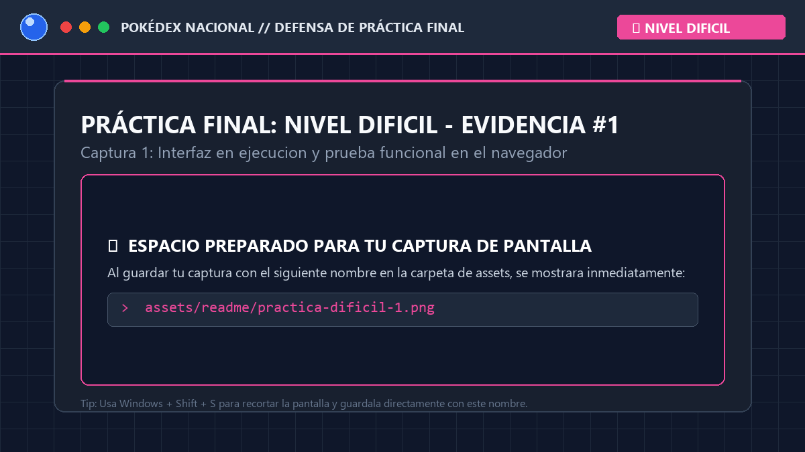

##### Captura 2: Código implementado o depuración en consola de la lógica algorítmica


---

#### 💡 Guía Documentada: Código Listo para Prácticas de Nivel Difícil

<details>
<summary>▶ <b>Caso Difícil A: Minijuego "¿Quién es ese Pokémon?" (El ejercicio más completo e impresionante)</b> [DESPLEGAR]</summary>

**1. Estructura HTML en `index.html` (dentro de un `<dialog id="modal-minijuego">`):**
```html
<dialog id="modal-minijuego" class="modal-dialog">
  <div class="minijuego-panel">
    <button id="btn-cerrar-juego" class="modal__btn-cerrar" type="button">✕</button>
    <h2 class="minijuego__titulo">¿QUIÉN ES ESE POKÉMON?</h2>
    
    <div class="minijuego__escenario">
      
    </div>

    <p id="juego-pista" class="juego-pista">Pista: Tipo desconocido</p>
    
    <div class="juego-formulario">
      <input id="juego-input" type="text" placeholder="Escribe el nombre del Pokémon..." autocomplete="off">
      <button id="juego-btn-adivinar" type="button">¡Adivinar!</button>
    </div>

    <div class="juego-marcador">
      <span>Racha actual: <b id="juego-racha">0</b></span>
      <span>Máxima racha: <b id="juego-record">0</b></span>
    </div>
    
    <div id="juego-mensaje" class="juego-mensaje"></div>
    <button id="juego-btn-siguiente" class="btn-siguiente" style="display: none;" type="button">Siguiente Pokémon ▶</button>
  </div>
</dialog>
```

**2. Estilos CSS en `css/style.css`:**
```css
/* Efecto de silueta negra pura para ocultar la identidad */
.juego-imagen.silueta {
  filter: brightness(0) contrast(200%);
  transition: filter 0.8s ease-in-out, transform 0.4s ease;
}

/* Estado desvelado al acertar */
.juego-imagen.revelado {
  filter: brightness(1) contrast(100%);
  animation: pulso-revelacion 0.6s ease-out;
}

@keyframes pulso-revelacion {
  0% { transform: scale(0.9); }
  50% { transform: scale(1.15); filter: drop-shadow(0 0 20px #38bdf8); }
  100% { transform: scale(1); }
}
```

**3. Lógica JavaScript completa en `js/app.js`:**
```javascript
let pokemonActualJuego = null;
let rachaAciertos = 0;
let recordAciertos = 0;

const modalJuego = document.querySelector("#modal-minijuego");
const imgSilueta = document.querySelector("#juego-silueta");
const inputJuego = document.querySelector("#juego-input");
const btnAdivinar = document.querySelector("#juego-btn-adivinar");
const btnSiguiente = document.querySelector("#juego-btn-siguiente");
const textoPista = document.querySelector("#juego-pista");
const textoMensaje = document.querySelector("#juego-mensaje");
const textoRacha = document.querySelector("#juego-racha");
const textoRecord = document.querySelector("#juego-record");

const iniciarRondaJuego = () => {
  if (todosLosPokemon.length === 0) return;
  
  // Selección pseudoaleatoria entre los 151 Pokémon
  const indiceAleatorio = Math.floor(Math.random() * todosLosPokemon.length);
  pokemonActualJuego = todosLosPokemon[indiceAleatorio];

  imgSilueta.src = pokemonActualJuego.spriteFront;
  imgSilueta.classList.remove("revelado");
  imgSilueta.classList.add("silueta");

  inputJuego.value = "";
  inputJuego.disabled = false;
  btnAdivinar.disabled = false;
  btnSiguiente.style.display = "none";
  textoMensaje.textContent = "";
  textoPista.textContent = `Pista: Tipo ${pokemonActualJuego.tipos.join(" / ")} | Letras: ${pokemonActualJuego.nombre.length}`;
  inputJuego.focus();
};

const comprobarRespuesta = () => {
  const respuestaUsuario = inputJuego.value.trim().toLowerCase();
  if (!respuestaUsuario) return;

  if (respuestaUsuario === pokemonActualJuego.nombre.toLowerCase()) {
    // ¡ACIERTO!
    imgSilueta.classList.remove("silueta");
    imgSilueta.classList.add("revelado");
    rachaAciertos++;
    if (rachaAciertos > recordAciertos) recordAciertos = rachaAciertos;

    textoRacha.textContent = rachaAciertos;
    textoRecord.textContent = recordAciertos;
    textoMensaje.innerHTML = `<span style="color: #4ade80;">¡Correcto! ¡Es <b>${pokemonActualJuego.nombre}</b>!</span>`;
    inputJuego.disabled = true;
    btnAdivinar.disabled = true;
    btnSiguiente.style.display = "inline-block";
  } else {
    // ¡FALLO!
    textoMensaje.innerHTML = `<span style="color: #f87171;">¡Incorrecto! Inténtalo de nuevo.</span>`;
    rachaAciertos = 0;
    textoRacha.textContent = rachaAciertos;
  }
};

if (btnAdivinar) btnAdivinar.addEventListener("click", comprobarRespuesta);
if (inputJuego) {
  inputJuego.addEventListener("keyup", (e) => {
    if (e.key === "Enter") comprobarRespuesta();
  });
}
if (btnSiguiente) btnSiguiente.addEventListener("click", iniciarRondaJuego);
```
* **Explicación técnica para defender:** Emplea propiedades de composición gráfica nativas de CSS (`filter: brightness(0)`), normalización estricta de cadenas para evitar falsos negativos por espacios o capitalizaciones, y sincronización de estado de juego reactivo sin llamadas externas.
</details>

<details>
<summary>▶ <b>Caso Difícil B: Comparador y Simulador de Batalla 1 vs 1 entre 2 Pokémon</b> [DESPLEGAR]</summary>

**En `js/app.js`:**
```javascript
const compararPokemon = (id1, id2) => {
  const p1 = todosLosPokemon.find(p => p.id === Number(id1));
  const p2 = todosLosPokemon.find(p => p.id === Number(id2));
  if (!p1 || !p2) return;

  const totalStats1 = Object.values(p1.stats).reduce((acc, v) => acc + v, 0);
  const totalStats2 = Object.values(p2.stats).reduce((acc, v) => acc + v, 0);

  const ganador = totalStats1 > totalStats2 ? p1.nombre : (totalStats2 > totalStats1 ? p2.nombre : "¡Empate técnico!");

  console.log("--- SIMULADOR DE COMBATE 1 VS 1 ---");
  console.log(`${p1.nombre} (Total Stats: ${totalStats1}) vs ${p2.nombre} (Total Stats: ${totalStats2})`);
  console.log(`Vencedor por estadísticas base: ${ganador}`);
  
  return { p1, p2, totalStats1, totalStats2, ganador };
};
```
</details>

<details>
<summary>▶ <b>Caso Difícil C: Simulador de Captura con Pokéball e Inventario</b> [DESPLEGAR]</summary>

**En `js/app.js`:**
```javascript
const intentarCaptura = (pokemon) => {
  // Fórmula de probabilidad: Pokémon con más PS o mayor ID son más difíciles
  const probabilidadBase = Math.max(15, Math.min(85, Math.round(100 - (pokemon.stats.hp / 2))));
  const tirada = Math.floor(Math.random() * 100) + 1;
  const capturado = tirada <= probabilidadBase;

  if (capturado) {
    const caja = JSON.parse(localStorage.getItem("pokedex_capturados") || "[]");
    caja.push({ id: pokemon.id, nombre: pokemon.nombre, fecha: new Date().toLocaleTimeString() });
    localStorage.setItem("pokedex_capturados", JSON.stringify(caja));
    alert(`¡Gotcha! ¡${pokemon.nombre} fue capturado con éxito!`);
  } else {
    alert(`¡Oh no! ¡${pokemon.nombre} se liberó de la Pokéball!`);
  }

  return capturado;
};
```
</details>

---

### 11.4. Guía Rápida de Soluciones, Código y Comandos de Emergencia

Esta sección es tu **chuleta rápida para la sesión de defensa en directo**. Contiene los conceptos clave, respuestas a las preguntas del profesor y los comandos exactos de Git.

#### 🎓 Preguntas Trampa del Profesor y Respuestas Preparadas

1. **"¿Por qué utilizaste `Promise.all` en lugar de un bucle `for` tradicional con `await fetch()`?"**
   * *Respuesta:* *"Un bucle con `await` realiza peticiones secuenciales: espera a que termine una para iniciar la siguiente. Con 151 Pokémon y 150 ms de latencia media, tardaría más de 22 segundos. Con `Promise.all()`, lanzamos las 151 peticiones concurrentemente en paralelo; la red las resuelve al mismo tiempo y todo concluye en apenas 1-2 segundos."*

2. **"¿Por qué guardas los Pokémon en `todosLosPokemon` en lugar de llamar a la API cada vez que el usuario escribe?"**
   * *Respuesta:* *"PokéAPI no dispone de un endpoint para buscar fragmentos (buscar 'char' para obtener Charmander y Charizard daría error 404). Al tener los 151 objetos en memoria RAM, ejecutamos métodos nativos como `.filter()` e `.includes()`, lo que ofrece búsqueda instantánea con 0 ms de retraso y sin saturar los servidores de la API."*

3. **"¿Por qué utilizas delegación de eventos con `e.target.closest()` en lugar de añadir un `addEventListener` a cada botón de cada tarjeta?"**
   * *Respuesta:* *"Si añadimos un detector a cada botón de 151 tarjetas, tendríamos más de 300 listeners en memoria. Además, cada vez que filtramos y repintamos el HTML con `innerHTML`, esos listeners se destruirían y habría que volver a crearlos. Con un único listener en el contenedor padre `#resultado`, cualquier tarjeta creada dinámica o reactivamente sigue funcionando de forma limpia y eficiente."*

4. **"¿Cómo funciona el cambio de imagen de espaldas a frente sin hacer nuevas peticiones de red?"**
   * *Respuesta:* *"Guardamos las URLs de ambos sprites directamente en atributos personalizados de datos (`data-back` y `data-front`) en la etiqueta ``. En los eventos `mouseenter` y `mouseleave`, simplemente conmutamos la propiedad `.src` en el DOM local. Como el navegador ya tiene la imagen en caché, el cambio es inmediato y sin tráfico de red."*

5. **"¿Por qué usas el elemento nativo `<dialog>` para los detalles en vez de un `<div>` tradicional?"**
   * *Respuesta:* *"El elemento `<dialog>` es el estándar nativo de HTML5 para interfaces modales accesibles. Ofrece control nativo de foco con `showModal()`, bloqueo automático del contenido inferior, desenfoque de fondo con el pseudoelemento `::backdrop` y soporte nativo para cerrar la ventana con la tecla `Escape` sin escribir código extra."*

---

#### ⌨️ Comandos Rápidos de Git para Guardar y Subir las Prácticas
Cuando el profesor te diga que guardes tu trabajo, abre la terminal en la carpeta del proyecto y ejecuta:

```bash
# 1. Comprobar archivos modificados
git status

# 2. Añadir todos los cambios y las capturas
git add .

# 3. Crear commit descriptivo según la práctica realizada:
# Para la fácil:
git commit -m "feat(evaluacion): implementacion y evidencias de practica facil"

# Para la media:
git commit -m "feat(evaluacion): implementacion y evidencias de practica media"

# Para la dificil:
git commit -m "feat(evaluacion): implementacion y evidencias de practica dificil"

# 4. Subir los cambios a GitHub
git push origin main
```

---

#### 📸 Cómo sustituir las capturas de pantalla en 10 segundos
1. Realiza la captura de pantalla en Windows pulsando **`Win + Shift + S`** y selecciona el área.
2. Abre la captura o guárdala directamente con estos nombres en la carpeta `assets/readme/`:
   * Práctica Fácil: `practica-facil-1.png` y `practica-facil-2.png`
   * Práctica Media: `practica-media-1.png` y `practica-media-2.png`
   * Práctica Difícil: `practica-dificil-1.png` y `practica-dificil-2.png`
3. Al sobrescribir el archivo, **¡automáticamente aparecerá tu captura en el README de GitHub sin tener que modificar una sola línea de texto!**
